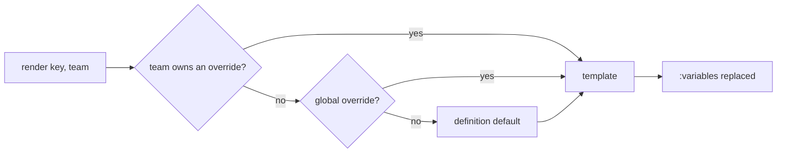

# Prompt registry

The application and its packages declare their editable prompts in the
`PromptRegistry`. These are agent system instructions, message templates and MCP
server instructions. Each definition ships a default template with `:variable`
placeholders. A settings screen stores overrides, globally or for one team,
through the [`SettingStore`](../advanced/host-integration.md).



## Declaring prompts

```php
use OiLab\OiLaravelAi\Data\AiPromptVariableData;
use OiLab\OiLaravelAi\Data\PromptDefinition;
use OiLab\OiLaravelAi\Facades\Prompts;
use OiLab\OiLaravelAi\Support\PromptRegistry;

// In a service provider's boot(): declare the prompt and its default template.
app(PromptRegistry::class)->define(new PromptDefinition(
    key: 'desk.ticket_analyse.system',
    label: 'Analyse d\'un ticket',
    default: "Tu analyses les tickets de :app_name.\nTypes :\n:ticket_types",
    variables: [new AiPromptVariableData('ticket_types', 'Types (code : nom)', '- BUG : Bug')],
    group: 'Desk',
));

// In the agent: the team override, else the global one, else the default.
public function instructions(): string
{
    return Prompts::render('desk.ticket_analyse.system', ['ticket_types' => $types], teamId: $this->teamId);
}
```

| Argument | Purpose |
| --- | --- |
| `key` | Unique key, also used for the setting (`PROMPTS.<key>`) |
| `label`, `group`, `description` | Shown by the settings screen |
| `default` | Template shipped with the code |
| `variables` | `AiPromptVariableData(name, description, example)` the code fills |
| `kind` | `PromptKind::System`, `Message` or `Mcp` |
| `teamOverridable` | `false` keeps a single global version |

## Rendering

Pass the team explicitly. Agents usually run in queued jobs, where no "current
team" exists.

Substitution is a single `strtr` pass. A value containing `:something` is never
expanded again, and the longest placeholder wins. `:app_name` and `:today` are
always available. Declare more globals with
`PromptRegistry::global(AiPromptVariableData, Closure)`.

## Editing

| Method | Purpose |
| --- | --- |
| `Prompts::template($key, $team)` | Raw template for a team |
| `Prompts::source($key, $team)` | `PromptSource::Team`, `Global` or `Default` |
| `Prompts::save($key, $template, $team)` | Store the override of a team (`null` = global) |
| `Prompts::reset($key, $team)` | Remove that override so the next layer applies |
| `Prompts::preview($key, $team, $template)` | Render with each variable's example value |
| `Prompts::fingerprint($key, $team)` | Short hash of the template in use |

A blank override counts as absent. Telling a team's own override from the
global one requires a `ScopedSettingStore`. The `oi-laravel-settings` adapter is
one, from settings 1.1. Without a bound store, the defaults are used and
`save()` throws.

## Legacy registry

`AiPromptVariableRegistry`, with its hardcoded constants and `compile()`, is
deprecated. Declare prompts in the `PromptRegistry` instead.
